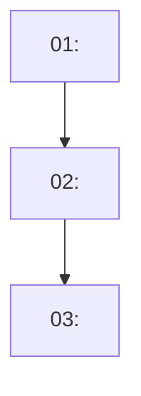

# Phases 3, 4 & 5 Reference: First-Principles Synthesis, Glossary, Derivations, MOC, Cornell Notes, Subtopic Deep-Dives, Flashcards & Zettelkasten

---

## 1. Phase 3A: First-Principles & Adversarial Models (`05-MENTAL-MODELS.md`)

Combine Feynman translation with divergent-to-convergent first-principles deconstruction, ASCII architecture diagrams, and adversarial pre-mortem inversion:

````markdown
# Mental Models & First-Principles Breakdown: <Topic Title>

## 1. Zero-Jargon Feynman Core
<Explain the entire mechanism in 2-3 paragraphs of plain everyday English using one concrete, physical analogy. Highlight both where the analogy holds and where it breaks down.>

## 2. First-Principles Axiom Stack
Rebuild `<topic>` from irreducible truths:
1. **Axiom 1 (<Fundamental Constraint/Truth>):** <Why this must be true regardless of implementation.>
2. **Axiom 2 (<Derived Necessity>):** <How combining Axiom 1 with the core problem constraint forces the design.>
3. **Axiom 3 (<Architectural Consequence>):** <Why the system takes its canonical shape.>

## 3. System Architecture & Flow Diagram (ASCII)
```text
<Clean ASCII diagram showing components, data/control flow, and state transitions>
```

## 4. Adversarial Pre-Mortem (How to Break It)
Assume the system just caused a catastrophic production outage or subtle data corruption. How did it happen?
1. **Failure Mode 1 (<Name>):**
   - *Trigger:* <Exact condition or workload that triggers the failure>
   - *Blast Radius:* <Silent corruption, latency spike, deadlock, or crash>
   - *Defensive Invariant:* <How to prevent, detect, or mitigate it>
2. **Failure Mode 2 (<Name>):**
   - *Trigger:* <Exact condition or workload>
   - *Blast Radius:* <Impact>
   - *Defensive Invariant:* <Mitigation>
3. **Failure Mode 3 (<Name>):**
   - *Trigger:* <Exact condition or workload>
   - *Blast Radius:* <Impact>
   - *Defensive Invariant:* <Mitigation>
````

---

## 2. Phase 3B: Canonical Domain Glossary (`04-GLOSSARY.md`)

Keep `04-GLOSSARY.md` lean, authoritative, and strictly focused on **what each term IS** (never dump implementation tutorials or usage guides into the glossary):

```markdown
# Canonical Glossary: <Topic Title>

> **Rule:** Every definition is 1-2 sentences stating *what the term IS*. Use the canonical term consistently across all notes and discussions.

- **<Canonical Term 1>:** <1-2 sentence crisp definition stating what the term IS.>
  _Avoid:_ <Sloppy or overloaded synonym/alias to avoid>.
- **<Canonical Term 2>:** <1-2 sentence crisp definition stating what the term IS.>
  _Avoid:_ <Sloppy or overloaded synonym/alias to avoid>.
```

---

## 3. Phase 3C: Step-by-Step Derivations Appendix (`06-DERIVATIONS-AND-PROOFS.md`)

Ensure zero "magic formulas" appear anywhere in the vault by deriving every major equation, complexity bound, and theorem step-by-step from base axioms:

```markdown
# Step-by-Step Derivations & Proofs: <Topic Title>

> **Rule:** Every major equation, complexity bound, and theorem is derived from base axioms with explicit step-by-step justifications.

## 1. Derivation of <Formula / Theorem Name>
- **Target Formula:**
$$
<Target LaTeX Equation>
$$
- **Starting Axioms / Premises:** <Explicit base definitions, axioms, or assumptions from `04-GLOSSARY.md` / `05-MENTAL-MODELS.md`>.
- **Cross-References:** [[topics/<nn>-<subtopic-slug>]] | [[04-GLOSSARY#<term>]]

### Step-by-Step Proof
1. **Step 1:**
   $$<Starting expression>$$
   *Why this holds:* <1-sentence justification>.
2. **Step 2:**
   $$<Intermediate algebraic or logical transition>$$
   *Why this holds:* <1-sentence justification>.
3. **Step 3 (Final Form):**
   $$<Target LaTeX Equation>$$
   *Why this holds:* <1-sentence justification>.
```

---

## 4. Mandatory Formula Anatomy Breakdown Standard (Progressive Depth Stage 2 & 3 Schema)

**Non-Negotiable Rules:**
- Across `02-DEEP-RESEARCH.md`, `03-CORNELL-STUDY-GUIDE.md`, and **every** `topics/<nn>-<subtopic-slug>.md` file, **no mathematical formula, equation, recurrence, objective/loss function, or complexity bound** may appear without:
  1. **Zero-Baseline Micro-Bridge** for any new symbol/operator not yet defined in plain English (2–3 lines + tiny 2-number example).
  2. **Mathematical Intuition (Before Symbols)** explaining the geometric, scaling, or behavioral meaning in plain English before formal notation.
  3. **Complete Formula Anatomy Breakdown** immediately following the equation (`I Do` walkthrough skipping zero algebraic steps + Depth Stage 3 limiting behaviors).
- **Zero Backtick-Wrapped Math:** **NEVER** wrap inline or display LaTeX delimiters in backticks anywhere—especially not inside Markdown table cells. Always write raw `$` / `$$` math delimiters directly without code ticks.
- **Table-Safe LaTeX Delimiters & Escaping:** Inside Markdown table cells, **NEVER** use raw pipe `|` characters inside math (always use `\mid`, `\lvert`, `\rvert`, `\lVert`, `\rVert`). Keep single-line inline math free of unescaped newlines and verify every opening and closing math delimiter matches.
- **Zero-Dead-Link Generation:** Only emit `[[wikilinks]]` or `[text](path.md)` links whose exact target file exists on disk (never link to hypothetical files or `[[none]]`).

```markdown
- **Mathematical Intuition (Before Symbols):** <2–3 sentences of plain-English geometric, scaling, or behavioral intuition explaining what the math is doing before showing formal notation.>

$$
<Display LaTeX Equation>
$$

| Symbol / Operator | Name, Domain / Shape & Physical Role | Directional Sensitivity |
|---|---|---|
| $x$ | <Name, plain-language role, units / domain / shape, e.g. $\mathbb{R}^d$> | <What happens to the output when $x$ increases or decreases> |
| $\sum_{i=1}^{n}$ | <Summation operator over all $n$ items; dimensionless aggregator> | <More terms / larger positive terms increase the sum linearly> |
| ... | ... | ... |

- **`I Do` (Thinking-Aloud Worked Walkthrough):**
  1. **Inputs (Concrete Numbers):** <Concrete numbers with units/shapes—start simple before scaling>.
  2. **Step-by-Step Algebraic Substitution (Zero Skipped Steps):** <Narrate why every single arithmetic operation happens, line by line>.
  3. **Final Evaluation & Plain-English Meaning:** <Final number + intuitive interpretation>.
- **Limiting Behaviors & Edge Cases (Depth Stage 3):**
  - Input $= 0$: <Exact mathematical & physical/system behavior>.
  - Input $= 1$ (if applicable): <Exact behavior>.
  - Input $\to \infty$: <Exact behavior / asymptote / saturation>.
  - Negative / degenerate inputs (if applicable): <Exact failure, clamping, or sign-flip behavior>.
```

*Every single variable, subscript, superscript, constant, and mathematical operator ($\sum$, $\prod$, $\nabla$, $\log$, $\arg\max$, $\mathbb{E}$, norms, matrices, etc.) in the equation MUST have a row in the Symbol & Operator Anatomy Table.*

---

## 5. Phase 4A: Master Cornell Study Guide (`03-CORNELL-STUDY-GUIDE.md`)

Synthesize `00-MISSION.md`, `02-DEEP-RESEARCH.md`, `04-GLOSSARY.md`, `05-MENTAL-MODELS.md`, `06-DERIVATIONS-AND-PROOFS.md`, and every `topics/<nn>-<subtopic-slug>.md` file into a comprehensive Markdown study guide. Its syllabus index and sections MUST explicitly link to **every single** `[[topics/<nn>-<subtopic-slug>]]` file created.

````markdown
# Cornell Study Guide: <Topic Title>

- **Date:** <YYYY-MM-DD>
- **Map of Content:** [[00-MOC-INDEX]]
- **Mission:** [[00-MISSION]] | **Research:** [[02-DEEP-RESEARCH]] | **Glossary:** [[04-GLOSSARY]] | **Models:** [[05-MENTAL-MODELS]] | **Derivations:** [[06-DERIVATIONS-AND-PROOFS]] | **Flashcards:** [[08-FLASHCARDS]]
- **Executive Thesis:** <2-sentence synthesis capturing the core mechanism and why it matters.>

---

## Complete Syllabus Index
> Every subtopic below has a dedicated, full-length deep-dive file in `topics/`.

1. [[topics/01-<subtopic-slug>]] — <1-line summary of what this subtopic covers>
2. [[topics/02-<subtopic-slug>]] — <1-line summary>
...
NN. [[topics/<nn>-<subtopic-slug>]] — <1-line summary>

---

## 1. <Milestone 1 Title>
*Deep-dive files:* [[topics/01-<subtopic-slug>]], [[topics/02-<subtopic-slug>]]

<Thorough, structured explanation using **bold terms** from `04-GLOSSARY.md` on first appearance, bullet points, and inline [Source] citations. Any formula here MUST include its full Formula Anatomy Breakdown.>

### Worked Example / Annotated Code
```<language>
// Concrete, realistic, annotated example (never foo/bar placeholders)
```

### Active-Recall Cue Questions (Milestone 1)
- **Cue 1:** <Diagnostic or mechanism-tracing question?>
  <details><summary>Reveal Answer</summary>
  <Crisp, complete answer grounded in first principles and primary sources.>
  </details>
- **Cue 2:** <Edge-case or failure-prediction question?>
  <details><summary>Reveal Answer</summary>
  <Crisp, complete answer explaining what breaks and why.>
  </details>

---

## 2. <Milestone 2 Title>
*Deep-dive files:* [[topics/03-<subtopic-slug>]], ...

<Thorough, structured explanation of internal architecture, state transitions, and invariants [Source], with Formula Anatomy Breakdowns for any equations.>

### Active-Recall Cue Questions (Milestone 2)
- **Cue 1:** <Why does invariant X hold under condition Y?>
  <details><summary>Reveal Answer</summary>
  <Complete explanation.>
  </details>

---

## 3. Trade-Offs, Edge Cases & Comparative Matrix
| Criterion | <Topic> | <Alternative A> | <Alternative B> |
|---|---|---|---|
| **Mechanism** | ... | ... | ... |
| **Latency / Throughput** | ... | ... | ... |
| **Failure Mode** | ... | ... | ... |
| **When to Choose** | ... | ... | ... |

### Active-Recall Cue Questions (Milestone 3 & 4)
- **Cue 1:** <Scenario-based design trade-off question?>
  <details><summary>Reveal Answer</summary>
  <Complete trade-off analysis.>
  </details>

---

## Cornell Summary Synthesis (Bottom-Line Takeaways)
1. **Core Problem Solved:** <1-sentence takeaway>
2. **Key Architectural Mechanism:** <1-sentence takeaway>
3. **Critical Invariant:** <1-sentence takeaway>
4. **Sharpest Edge / Failure Mode:** <1-sentence takeaway>
5. **Decision Rule:** <When to use `<topic>` vs. when to reach for an alternative.>

---

## Living Session Notes & Insights
- *[<YYYY-MM-DD>]* <Initial vault synthesis completed. Ongoing Socratic insights, war stories, and follow-up Q&A are appended here automatically.>
````

---

## 6. Phase 4B: Dedicated Per-Subtopic Deep-Dive Files (`topics/<nn>-<subtopic-slug>.md`)

For **every single topic and subtopic** in the Phase 2 exhaustive syllabus (no arbitrary file cap; never compress, merge, or skip subtopics), generate a full-length, standalone Markdown file inside `~/notes/<topic-slug>/topics/<nn>-<subtopic-slug>.md` numbered sequentially (`01-...`, `02-...`, etc.).

**Progressive Absolute-Zero-to-Mastery Architecture (Matches Live Phase 6 Lessons):**
Every saved subtopic file MUST mirror the progressive 3-stage escalation used in live teaching—starting from **zero assumed prerequisites** and escalating cleanly to formal equations, complete worked steps, and adversarial edge cases:
1. **Zero-Baseline Prerequisite Micro-Bridge & Engineering Motivation:** Define every new symbol, operator, or technical term from scratch in 2–3 plain-English lines with a tiny 2-number example, then state in 2 sentences what failed or was clumsy previously.
2. **Depth Stage 1 — Intuition, Visuals & Mechanism:** Vivid daily-life analogy + 1-line Mental Hook, step-by-step causal mechanism (`Input → Internal Transformation → Output`), clean ASCII visual diagram, Contrastive Boundary ("What It Is vs. What It Is NOT"), and **Where the Analogy Breaks Down**.
3. **Depth Stage 2 — Mathematical Intuition, Formal Equation & `I Do` Trace:** Plain-English mathematical intuition *before* symbols, formal governing equation in pure display LaTeX (zero backticks, `\mid` in tables), complete Symbol & Operator Anatomy Table, and a thinking-aloud `I Do` walkthrough skipping zero algebraic steps.
4. **Depth Stage 3 — Deeper Nuances, Limiting Behaviors & Advanced Connections:** Scaling/limiting behaviors ($0, 1, \infty$, negative/degenerate inputs), why alternative formulations fail, and links to advanced downstream topics.
5. **Worked Code + Progressive Self-Check Ladder:** Guided (`We Do` with 2 faded blanks), Cold Solo (`You Do`), and Adversarial Edge-Case + 2-sentence Feynman Teach-Back inside `<details>` blocks.

````markdown
---
topic: "<Topic Title>"
subtopic: "<Subtopic Title>"
order: <nn>
prerequisites:
  - "[[topics/<prereq-subtopic>]]" # or [] if none
parent: "[[03-CORNELL-STUDY-GUIDE]]"
---

# <nn>. <Subtopic Title>

## 1. Zero-Baseline Prerequisite Micro-Bridge & Engineering Motivation
- **Prerequisite Micro-Bridge (Absolute-0 Guarantee):**
  - **<New Term / Symbol 1>:** <2–3 plain-English lines defining it from scratch, followed by a tiny 2-number example.>
  - **<New Term / Symbol 2>:** <2–3 plain-English lines + tiny 2-number example.>
- **Why This Exists (Engineering Motivation):** <2 sentences explaining what failed or was clumsy in the previous subtopic/baseline that forced this concept to be invented.>

## 2. Depth Stage 1 — Intuition, Visuals & Mechanism
- **Daily-Life Intuition:** <Vivid, relatable physical or real-world analogy explaining the core behavior without jargon.>
- **1-Line Mental Hook:** <One crisp sentence locking in the core intuition.>
- **Step-by-Step Mechanism (`Input → Internal Transformation → Output`):**
  1. **Input:** <What enters the mechanism using **bolded canonical terms** from `04-GLOSSARY.md`.>
  2. **Internal Transformation:** <Exact causal rule/state transition and why it works [Source].>
  3. **Output:** <What comes out and what invariant holds.>

```text
<Clean ASCII coordinate, flow, or geometry diagram illustrating the concept visually>
```

- **Contrastive Boundary ("What It Is vs. What It Is NOT"):** <Explicitly distinguish this concept from lookalike mechanisms and explain why the lookalike fails [Source].>
- **Where the Analogy Breaks Down:** <Explicit boundary where the everyday analogy stops matching mathematical/system reality.>

## 3. Depth Stage 2 — Mathematical Intuition, Formal Equation & `I Do` Trace
- **Mathematical Intuition (Before Symbols):** <Plain-English geometric, scaling, or behavioral explanation of what the math is doing before writing formal notation.>

$$
<Display LaTeX Equation>
$$

| Symbol / Operator | Name, Domain / Shape & Physical Role | Directional Sensitivity |
|---|---|---|
| $x$ | <Name, plain-language role, units / domain / shape> | <Effect on output when $x$ increases or decreases> |
| ... | ... | ... |

*(If a purely non-mathematical subtopic has no formal equations, explicitly state "No formal equations govern this mechanism" and provide exact complexity/capacity bounds or invariant inequalities with full breakdown.)*

- **`I Do` (Thinking-Aloud Worked Walkthrough):**
  1. **Concrete Inputs:** <Realistic scalar/numeric inputs with units/shapes>.
  2. **Step-by-Step Arithmetic (Zero Skipped Algebraic Steps):** <Narrate why every single arithmetic operation happens>.
  3. **Final Answer & Plain-English Meaning:** <Result + intuitive interpretation>.

## 4. Depth Stage 3 — Deeper Nuances, Limiting Behaviors & Advanced Connections
- **Limiting Behaviors & Boundary Cases:**
  - Input $= 0$: <Exact behavior>.
  - Input $= 1$ (if applicable): <Exact behavior>.
  - Input $\to \infty$: <Exact asymptotic/saturation behavior>.
  - Negative / degenerate inputs: <Exact failure, clamping, or boundary behavior>.
- **Why Alternative Formulations Fail & Trade-offs:** <What breaks in naive alternatives and what this formulation optimizes vs. sacrifices [Source].>
- **Connections to Advanced Topics:** <How this mechanism scales or connects forward to [[topics/<next-subtopic>]] and downstream architectures.>

## 5. Worked Examples / Annotated Code
```<language>
// Realistic, end-to-end annotated example (never foo/bar placeholders)
```

## 6. Progressive Self-Check Ladder (`We Do` → `You Do` → Feynman Gate)
- **Guided Practice (`We Do`):** <Richer problem with ~60% of steps completed and `[Step 2: ___]`, `[Step 4: ___]` blanks.>
  <details><summary>Reveal Guided Steps</summary>
  <Exact step-by-step fill-ins with zero skipped arithmetic.>
  </details>
- **Cold Solo Problem (`You Do`):** <Fresh problem with zero scaffolding.>
  <details><summary>Reveal Solo Solution</summary>
  <Complete step-by-step derivation and final answer.>
  </details>
- **Adversarial Edge-Case & 2-Sentence Feynman Check:** <Tricky boundary/failure input + "Explain this in 2 plain-English sentences with zero unstated jargon.">
  <details><summary>Reveal Mastery Answer</summary>
  <Boundary outcome + model 2-sentence plain-English Feynman explanation.>
  </details>

---
**Navigation:** ← [[<prev-subtopic>|Previous]] | [[03-CORNELL-STUDY-GUIDE|Study Guide]] | [[<next-subtopic>|Next]] →
````

---

## 7. Phase 4C: Master Map of Content (`00-MOC-INDEX.md`)

Create `~/notes/<topic-slug>/00-MOC-INDEX.md` as the central navigation dashboard so Obsidian and Markdown navigation stays effortless regardless of vault size:

````markdown
# Map of Content (MOC): <Topic Title>

## Vault Navigation
- [[00-MISSION]] — Target outcome, success criteria & scope boundaries
- [[01-RESOURCES]] — Primary Knowledge, practitioner Wisdom, exhaustive syllabus & gaps
- [[02-DEEP-RESEARCH]] — Primary-source research dossier & benchmarks
- [[03-CORNELL-STUDY-GUIDE]] — Master synthesized study guide
- [[04-GLOSSARY]] — Canonical 1–2 sentence domain definitions
- [[05-MENTAL-MODELS]] — Feynman analogies, axioms, ASCII architecture & pre-mortem
- [[06-DERIVATIONS-AND-PROOFS]] — Step-by-step axiom-to-formula derivations
- [[07-PRACTICE-PROBLEMS]] — Applied problem sets & scenarios (if generated)
- [[08-FLASHCARDS]] — Spaced-repetition & cloze active-recall deck
- [[09-CHEAT-SHEET]] — Distilled 1-page executive cheat sheet (via `/teachme distill`)

---

## Comparisons
- <Cross-vault comparisons linked here automatically by `/teachme compare`, e.g. `[[../comparisons/<topic-a>-vs-<topic-b>]]`>

---

## Prerequisite & Dependency Graph



### ASCII Dependency Tree (Plain-Text Fallback)
```text
01: <Subtopic A>
└── 02: <Subtopic B>
    └── 03: <Subtopic C>
```

---

## Complete Subtopic Syllabus Tracker (`topics/`)
> Check off `- [x]` as each subtopic is mastered during Phase 6.

- [ ] **01.** [[topics/01-<subtopic-slug>]] `[Beginner]` — *Prereqs: None*
- [ ] **02.** [[topics/02-<subtopic-slug>]] `[Intermediate]` — *Prereqs: [[topics/01-<subtopic-slug>]]*
- [ ] **03.** [[topics/03-<subtopic-slug>]] `[Advanced]` — *Prereqs: [[topics/02-<subtopic-slug>]]*

---

## Atomic Zettelkasten Concept Index (`atomic/`)
- [ ] [[atomic/<concept-slug-1>]] `[Beginner]` — *Parent:* [[topics/01-<subtopic-slug>]]
- [ ] [[atomic/<concept-slug-2>]] `[Intermediate]` — *Parent:* [[topics/02-<subtopic-slug>]]
````

---

## 8. Phase 4D: Spaced-Repetition Cloze & Flashcard Deck (`08-FLASHCARDS.md`)

Generate `~/notes/<topic-slug>/08-FLASHCARDS.md` formatted cleanly for **Obsidian Spaced Repetition** (`#flashcards/<topic-slug>`) and **Anki** import:

```markdown
# Spaced-Repetition Flashcards: <Topic Title>

#flashcards/<topic-slug>

## 1. Conceptual & Mechanism Cards

<Single-line question testing an invariant, trade-off, or failure mode> :: <Crisp, exact answer>

<Multi-line diagnostic question>
?
<Complete, structured answer grounded in `04-GLOSSARY.md` and `05-MENTAL-MODELS.md`.>

---

## 2. Formula & Symbol Cloze Cards

For `<Formula Name>` ($$<Equation>$$): the term ==$<symbol>$== represents ==<exact name, role, and units>==; as ==$<symbol>$== $\to \infty$, the output ==<limiting behavior>==.

For `<Formula Name>`: increasing ==$<variable>$== causes the output to ==<increase / decrease / saturate>== because ==<1-clause mathematical reason>==.
```

---

## 9. Phase 5: Atomic Zettelkasten Cards (`atomic/`)

Create standalone Markdown cards inside `~/notes/<topic-slug>/atomic/<concept-slug>.md` for every key mechanism, theorem, invariant, and failure mode (no arbitrary card cap). Each card must express **one atomic concept** in 150-300 words so it is reusable across vaults:

```markdown
---
tags:
  - <topic-slug>
  - evergreen
created: <YYYY-MM-DD>
status: evergreen
parent: "[[03-CORNELL-STUDY-GUIDE]]"
---

# <Atomic Concept Title>

<150-300 words explaining this single concept clearly in your own words, grounded in 04-GLOSSARY.md terminology and citing primary sources [Source]. Include a brief concrete example or invariant.>

## Related Concepts
- [[<sibling-concept-1>]] — <Explicit explanation of how or why it connects (e.g., "Enforces the invariant required by...")>
- [[<sibling-concept-2>]] — <Explicit explanation of dependency or contrast>
```
