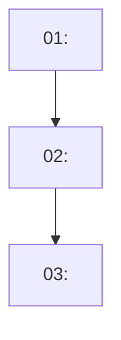

# Phases 3, 4 & 5 Reference: First-Principles Synthesis, Glossary, Derivations, MOC, Cornell Notes, Subtopic Deep-Dives, Flashcards & Zettelkasten

---

## 1. Phase 3A: First-Principles & Adversarial Models (`05-MENTAL-MODELS.md`)

Combine Feynman translation with divergent-to-convergent first-principles deconstruction, ASCII architecture diagrams, and adversarial pre-mortem inversion:

````markdown
# Mental Models & First-Principles Breakdown: <Topic Title>

## 1. Zero-Jargon Feynman Core
<Explain the entire mechanism in 2-3 paragraphs of plain everyday English using one concrete, physical analogy. Highlight both where the analogy holds and where it breaks down.>

## 2. First-Principles Axiom Stack
Rebuild `<topic>` from irreducible truths:
1. **Axiom 1 (<Fundamental Constraint/Truth>):** <Why this must be true regardless of implementation.>
2. **Axiom 2 (<Derived Necessity>):** <How combining Axiom 1 with the core problem constraint forces the design.>
3. **Axiom 3 (<Architectural Consequence>):** <Why the system takes its canonical shape.>

## 3. System Architecture & Flow Diagram (ASCII)
```text
<Clean ASCII diagram showing components, data/control flow, and state transitions>
```

## 4. Adversarial Pre-Mortem (How to Break It)
Assume the system just caused a catastrophic production outage or subtle data corruption. How did it happen?
1. **Failure Mode 1 (<Name>):**
   - *Trigger:* <Exact condition or workload that triggers the failure>
   - *Blast Radius:* <Silent corruption, latency spike, deadlock, or crash>
   - *Defensive Invariant:* <How to prevent, detect, or mitigate it>
2. **Failure Mode 2 (<Name>):**
   - *Trigger:* <Exact condition or workload>
   - *Blast Radius:* <Impact>
   - *Defensive Invariant:* <Mitigation>
3. **Failure Mode 3 (<Name>):**
   - *Trigger:* <Exact condition or workload>
   - *Blast Radius:* <Impact>
   - *Defensive Invariant:* <Mitigation>
````

---

## 2. Phase 3B: Canonical Domain Glossary (`04-GLOSSARY.md`)

Keep `04-GLOSSARY.md` lean, authoritative, and strictly focused on **what each term IS** (never dump implementation tutorials or usage guides into the glossary):

```markdown
# Canonical Glossary: <Topic Title>

> **Rule:** Every definition is 1-2 sentences stating *what the term IS*. Use the canonical term consistently across all notes and discussions.

- **<Canonical Term 1>:** <1-2 sentence crisp definition stating what the term IS.>
  _Avoid:_ <Sloppy or overloaded synonym/alias to avoid>.
- **<Canonical Term 2>:** <1-2 sentence crisp definition stating what the term IS.>
  _Avoid:_ <Sloppy or overloaded synonym/alias to avoid>.
```

---

## 3. Phase 3C: Step-by-Step Derivations Appendix (`06-DERIVATIONS-AND-PROOFS.md`)

Ensure zero "magic formulas" appear anywhere in the vault by deriving every major equation, complexity bound, and theorem step-by-step from base axioms:

```markdown
# Step-by-Step Derivations & Proofs: <Topic Title>

> **Rule:** Every major equation, complexity bound, and theorem is derived from base axioms with explicit step-by-step justifications.

## 1. Derivation of <Formula / Theorem Name>
- **Target Formula:**
$$
<Target LaTeX Equation>
$$
- **Starting Axioms / Premises:** <Explicit base definitions, axioms, or assumptions from `04-GLOSSARY.md` / `05-MENTAL-MODELS.md`>.
- **Cross-References:** [[topics/<nn>-<subtopic-slug>]] | [[04-GLOSSARY#<term>]]

### Step-by-Step Proof
1. **Step 1:**
   $$<Starting expression>$$
   *Why this holds:* <1-sentence justification>.
2. **Step 2:**
   $$<Intermediate algebraic or logical transition>$$
   *Why this holds:* <1-sentence justification>.
3. **Step 3 (Final Form):**
   $$<Target LaTeX Equation>$$
   *Why this holds:* <1-sentence justification>.
```

---

## 4. Mandatory Formula Anatomy Breakdown Standard (Progressive Depth Stage 2 & 3 Schema)

**Non-Negotiable Rules:**
- Across `02-DEEP-RESEARCH.md`, `03-CORNELL-STUDY-GUIDE.md`, and **every** `topics/<nn>-<subtopic-slug>.md` file, **no mathematical formula, equation, recurrence, objective/loss function, or complexity bound** may appear without:
  1. **Zero-Baseline Micro-Bridge** for any new symbol/operator not yet defined in plain English (2–3 lines + tiny 2-number example).
  2. **Mathematical Intuition (Before Symbols)** explaining the geometric, scaling, or behavioral meaning in plain English before formal notation.
  3. **Complete Formula Anatomy Breakdown** immediately following the equation (`I Do` walkthrough skipping zero algebraic steps + Depth Stage 3 limiting behaviors).
- **Zero Backtick-Wrapped Math:** **NEVER** wrap inline or display LaTeX delimiters in backticks anywhere—especially not inside Markdown table cells. Always write raw `$` / `$$` math delimiters directly without code ticks.
- **Table-Safe LaTeX Delimiters & Escaping:** Inside Markdown table cells, **NEVER** use raw pipe `|` characters inside math (always use `\mid`, `\lvert`, `\rvert`, `\lVert`, `\rVert`). Keep single-line inline math free of unescaped newlines and verify every opening and closing math delimiter matches.
- **Zero-Dead-Link Generation:** Only emit `[[wikilinks]]` or `[text](path.md)` links whose exact target file exists on disk (never link to hypothetical files or `[[none]]`).

```markdown
- **Mathematical Intuition (Before Symbols):** <2–3 sentences of plain-English geometric, scaling, or behavioral intuition explaining what the math is doing before showing formal notation.>

$$
<Display LaTeX Equation>
$$

| Symbol / Operator | Name, Domain / Shape & Physical Role | Directional Sensitivity |
|---|---|---|
| $x$ | <Name, plain-language role, units / domain / shape, e.g. $\mathbb{R}^d$> | <What happens to the output when $x$ increases or decreases> |
| $\sum_{i=1}^{n}$ | <Summation operator over all $n$ items; dimensionless aggregator> | <More terms / larger positive terms increase the sum linearly> |
| ... | ... | ... |

- **`I Do` (Thinking-Aloud Worked Walkthrough):**
  1. **Inputs (Concrete Numbers):** <Concrete numbers with units/shapes—start simple before scaling>.
  2. **Step-by-Step Algebraic Substitution (Zero Skipped Steps):** <Narrate why every single arithmetic operation happens, line by line>.
  3. **Final Evaluation & Plain-English Meaning:** <Final number + intuitive interpretation>.
- **Limiting Behaviors & Edge Cases (Depth Stage 3):**
  - Input $= 0$: <Exact mathematical & physical/system behavior>.
  - Input $= 1$ (if applicable): <Exact behavior>.
  - Input $\to \infty$: <Exact behavior / asymptote / saturation>.
  - Negative / degenerate inputs (if applicable): <Exact failure, clamping, or sign-flip behavior>.
```

*Every single variable, subscript, superscript, constant, and mathematical operator ($\sum$, $\prod$, $\nabla$, $\log$, $\arg\max$, $\mathbb{E}$, norms, matrices, etc.) in the equation MUST have a row in the Symbol & Operator Anatomy Table.*

---

## 5. Phase 4A: Master Cornell Study Guide (`03-CORNELL-STUDY-GUIDE.md`)

Synthesize `00-MISSION.md`, `02-DEEP-RESEARCH.md`, `04-GLOSSARY.md`, `05-MENTAL-MODELS.md`, `06-DERIVATIONS-AND-PROOFS.md`, and every `topics/<nn>-<subtopic-slug>.md` file into a comprehensive Markdown study guide. Its syllabus index and sections MUST explicitly link to **every single** `[[topics/<nn>-<subtopic-slug>]]` file created.

````markdown
# Cornell Study Guide: <Topic Title>

- **Date:** <YYYY-MM-DD>
- **Map of Content:** [[00-MOC-INDEX]]
- **Mission:** [[00-MISSION]] | **Research:** [[02-DEEP-RESEARCH]] | **Glossary:** [[04-GLOSSARY]] | **Models:** [[05-MENTAL-MODELS]] | **Derivations:** [[06-DERIVATIONS-AND-PROOFS]] | **Flashcards:** [[08-FLASHCARDS]]
- **Executive Thesis:** <2-sentence synthesis capturing the core mechanism and why it matters.>

---

## Complete Syllabus Index
> Every subtopic below has a dedicated, full-length deep-dive file in `topics/`.

1. [[topics/01-<subtopic-slug>]] — <1-line summary of what this subtopic covers>
2. [[topics/02-<subtopic-slug>]] — <1-line summary>
...
NN. [[topics/<nn>-<subtopic-slug>]] — <1-line summary>

---

## 1. <Milestone 1 Title>
*Deep-dive files:* [[topics/01-<subtopic-slug>]], [[topics/02-<subtopic-slug>]]

<Thorough, structured explanation using **bold terms** from `04-GLOSSARY.md` on first appearance, bullet points, and inline [Source] citations. Any formula here MUST include its full Formula Anatomy Breakdown.>

### Worked Example / Annotated Code
```<language>
// Concrete, realistic, annotated example (never foo/bar placeholders)
```

### Active-Recall Cue Questions (Milestone 1)
- **Cue 1:** <Diagnostic or mechanism-tracing question?>
  <details><summary>Reveal Answer</summary>
  <Crisp, complete answer grounded in first principles and primary sources.>
  </details>
- **Cue 2:** <Edge-case or failure-prediction question?>
  <details><summary>Reveal Answer</summary>
  <Crisp, complete answer explaining what breaks and why.>
  </details>

---

## 2. <Milestone 2 Title>
*Deep-dive files:* [[topics/03-<subtopic-slug>]], ...

<Thorough, structured explanation of internal architecture, state transitions, and invariants [Source], with Formula Anatomy Breakdowns for any equations.>

### Active-Recall Cue Questions (Milestone 2)
- **Cue 1:** <Why does invariant X hold under condition Y?>
  <details><summary>Reveal Answer</summary>
  <Complete explanation.>
  </details>

---

## 3. Trade-Offs, Edge Cases & Comparative Matrix
| Criterion | <Topic> | <Alternative A> | <Alternative B> |
|---|---|---|---|
| **Mechanism** | ... | ... | ... |
| **Latency / Throughput** | ... | ... | ... |
| **Failure Mode** | ... | ... | ... |
| **When to Choose** | ... | ... | ... |

### Active-Recall Cue Questions (Milestone 3 & 4)
- **Cue 1:** <Scenario-based design trade-off question?>
  <details><summary>Reveal Answer</summary>
  <Complete trade-off analysis.>
  </details>

---

## Cornell Summary Synthesis (Bottom-Line Takeaways)
1. **Core Problem Solved:** <1-sentence takeaway>
2. **Key Architectural Mechanism:** <1-sentence takeaway>
3. **Critical Invariant:** <1-sentence takeaway>
4. **Sharpest Edge / Failure Mode:** <1-sentence takeaway>
5. **Decision Rule:** <When to use `<topic>` vs. when to reach for an alternative.>

---

## Living Session Notes & Insights
- *[<YYYY-MM-DD>]* <Initial vault synthesis completed. Ongoing Socratic insights, war stories, and follow-up Q&A are appended here automatically.>
````

---

## 6. Phase 4B: Detailed Subtopic Notes — 8-Block Standard (`topics/<nn>-<subtopic-slug>.md`)

For **every single topic and subtopic** in the Phase 2 exhaustive syllabus (no arbitrary file cap; never compress, merge, or skip subtopics), generate a deep, self-contained, zero-baseline-to-mastery reference file at `<VAULT_ROOT>/<topic-slug>/topics/<nn>-<subtopic-slug>.md` (`01-...`, `02-...`, etc.) partitioned with the strict Three-Tier Progressive Disclosure HTML anchors (`L1-ANCHOR`, `L2-PREREQS-AND-MOTIVATION`, `L3-FOUR-LAYER-THEORY`, `L4-DERIVATION-AND-CODE`, `L5-WORKBOOK-AND-GRAPH`).

### Exact 8-Block Subtopic Note Template

````markdown
---
id: "topic-<nn>"
title: "<Subtopic Title>"
status: "unstarted"
checkpoint: "0/4"
depends_on: ["topic-<prev>-<slug>"]
unlocks: ["topic-<next>-<slug>"]
contrasts_with: ["topic-<lookalike>-<slug>"]
fixes_failure_of: ["topic-<broken-method>-<slug>"]
key_equations:
  - "<clean LaTeX equation>"
---

# <nn>. <Subtopic Title>

<!-- SECTION: L1-ANCHOR -->
## 1. The 30-Second Executive Anchor
- **Core Thesis:** <2–3 sentences max stating clearly what problem this subtopic solves, how it works at a high level, and its single unbreakable invariant.>
- **One-Line Mental Hook:** <A vivid, memorable 1-sentence takeaway you can recall instantly during revision.>

<!-- SECTION: L2-PREREQS-AND-MOTIVATION -->
## 2. Zero-Baseline Prerequisite Micro-Bridge & Engineering Motivation

> [!note] Zero-Baseline Prerequisites
> Before using ANY mathematical symbol, operator, matrix/tensor notation, or domain term in this file, define every single one from absolute scratch in plain English with a tiny 2-number concrete micro-example (assuming zero prior math or domain knowledge):
> - **<Term / Symbol 1>:** <Plain-English definition from scratch + tiny 2-number example.>
> - **<Term / Symbol 2>:** <Plain-English definition from scratch + tiny 2-number example.>

### Engineering Motivation ("Why This Had to Be Invented")
<3–4 sentence causal explanation of what broke, scaled poorly, or failed in the previous subtopic that forced researchers/engineers to invent this exact concept [Source].>

<!-- SECTION: L3-FOUR-LAYER-THEORY -->
## 3. 4-Layer Deep Theory Stack

### Layer 1 — Daily-Life Intuition
<Rich, thorough prose—never terse bullet stubs—using a relatable, everyday physical or human analogy explaining the core behavior with zero jargon.>

### Layer 2 — Theoretical Mechanism, Visual Diagram & Contrastive Boundaries
- **Causal Mechanism (`Input → Internal State/Transformation → Output`):** <Detailed step-by-step walkthrough using **bolded canonical terms** from `04-GLOSSARY.md` and inline [Source] citations.>

```text
<Mandatory ASCII diagram illustrating the geometry, vector projection, data pipeline, or state transition>
```

#### Contrastive "Is vs. Is Not" Table
| Dimension | <This Concept> (What It IS) | <Closest Lookalike> (What It Is NOT) |
|---|---|---|
| **Core Mechanism** | <Exact mechanism> | <How the lookalike differs or fails> |
| **Invariant / Guarantee** | <What strictly holds> | <Where the lookalike breaks> |
| **Failure Mode** | <Real edge behavior> | <Lookalike trap> |

> [!warning] Where the Analogy Breaks Down
> <State clearly where Layer 1's everyday analogy stops matching the true mathematical or system mechanics.>

### Layer 3 — Mathematical Intuition (Before Symbols)
<Explain the geometric, scaling, directional, and limiting behavior of the math in rich plain English BEFORE writing any Greek symbols or formal equations.>

### Layer 4 — Formal Governing Mathematics & Complete Formula Anatomy
*(If a purely non-mathematical subtopic has no formal equations, explicitly state "No formal equations govern this mechanism" and provide exact complexity/capacity bounds or invariant inequalities with full breakdown.)*

$$
<Display LaTeX Equation>
$$

| Symbol / Operator | Name & Physical Role | Tensor Shape / Domain / Units | Directional Sensitivity |
|---|---|---|---|
| $x$ | <Name & plain-English role> | <Shape / domain / units> | <Effect when $x$ increases or decreases> |
| ... | ... | ... | ... |

- **Directional Sensitivity & Boundary Limits:**
  - As key input $\to 0$: <Exact behavior>.
  - As key input $\to 1$ / $-1$: <Exact behavior>.
  - Negative inputs / degenerate cases: <Exact sign-flip, clamping, or failure behavior>.
  - As key input $\to \infty$: <Exact asymptotic / saturation behavior>.

<!-- SECTION: L4-DERIVATION-AND-CODE -->
## 4. Step-by-Step Axiom Derivation
<Complete, zero-skip algebraic/logical derivation from base axioms to the final equation—zero "it is trivial to see that..." jumps.>
1. **Step 1 (Starting Axiom):**
   $$<Starting expression>$$
   *Why this step holds:* <1-sentence explicit justification>.
2. **Step 2 (Intermediate Transition):**
   $$<Intermediate step showing exact algebraic rule applied>$$
   *Why this step holds:* <1-sentence explicit justification>.
3. **Step 3 (Final Governing Equation):**
   $$<Final equation>$$
   *Why this step holds:* <1-sentence explicit justification>.

## 5. Executable "Code-as-Truth" Verification Block
```python
import numpy as np

# Self-contained 10-18 line verification matching the worked example
# Explicit variable shapes, concrete numbers, and assert invariants
x = np.array([2.0, 3.0], dtype=float)  # shape: (2,)
# ... compute expected vs. formula output ...
assert np.allclose(actual, expected), f"Invariant failed: {actual} != {expected}"
```

<!-- SECTION: L5-WORKBOOK-AND-GRAPH -->
## 6. Gradual-Release Practice Workbook (`I Do` → `We Do` → `You Do`)

### `I Do` (Fully Worked 3-Number Trace)
1. **Concrete Inputs:** <3 specific numbers matching the Code-as-Truth block>.
2. **Step-by-Step Arithmetic:** <Complete walkthrough with every arithmetic step narrated aloud>.
3. **Final Evaluation & Interpretation:** <Exact number + plain-English meaning>.

### `We Do` (Faded Fill-in-the-Blank)
<Second problem with ~60% of the steps shown and `[Step 2: ___]`, `[Step 4: ___]` missing for self-testing.>
<details><summary>Reveal Step-by-Step Solution</summary>
<Exact missing steps and final answer with zero skipped arithmetic.>
</details>

### `You Do` (Cold Solo + Adversarial Edge-Case Drill)
<Boundary-breaking problem (zero vector, degenerate input, or extreme scaling) with zero scaffolding.>
<details><summary>Reveal Step-by-Step Solution</summary>
<Verified solution, failure/boundary analysis, and 2-sentence plain-English Feynman check.>
</details>

## 7. Typed Knowledge Graph Footer & 4-Checkpoint Mastery Ledger

### Typed Semantic Links
- **Depends On:** [[topics/<prev>-<slug>]]
- **Unlocks:** [[topics/<next>-<slug>]]
- **Contrasts With:** [[topics/<lookalike>-<slug>]]
- **Fixes Failure Of:** [[topics/<broken-method>-<slug>]]
- **Atomic Concepts:** [[atomic/<concept-slug>]]

### 4-Checkpoint Mastery Ledger
- [ ] `[1/4]` Discovery Prediction
- [ ] `[2/4]` We-Do Faded Step
- [ ] `[3/4]` You-Do Cold Drill
- [ ] `[4/4]` Edge-Case & Feynman Gate

---
**Navigation:** ← [[<prev-subtopic>|Previous]] | [[03-CORNELL-STUDY-GUIDE|Study Guide]] | [[<next-subtopic>|Next]] →
````

### Mandatory 6-Point Writer -> Critic Audit (Before Saving Any `topics/*.md` File)
Before writing any generated or expanded `topics/<nn>-<subtopic-slug>.md` file to disk, self-audit all 6 checks and repair any failure immediately:
1. Every symbol in Block 3 (Layer 4) is defined in Block 2 (Prerequisite Micro-Bridge) or the Symbol & Operator Anatomy Table.
2. Zero skipped algebraic steps in Block 4 (every step carries an explicit `Why this step holds` justification).
3. Zero backtick-wrapped LaTeX delimiters (`$` or `$$` never enclosed in code ticks) and `\mid` used instead of raw `|` inside every Markdown table.
4. Includes an ASCII diagram, Contrastive "Is vs. Is Not" table, and `> [!warning] Where the Analogy Breaks Down` callout.
5. Includes a valid, runnable 10–18 line Python/NumPy `assert` verification snippet in Block 5.
6. All typed links (`depends_on`, `unlocks`, `contrasts_with`, `fixes_failure_of`, and Block 7 links) resolve to valid vault files on disk (or `[]` where none apply).
7. **Strict YAML Frontmatter Check:** Double-quote `"..."` all `description`, `title`, `checkpoint`, `key_equations`, and any YAML string value containing `:`, `|`, `[`, `]`, `{`, `}`, `<`, `>`, `*`, `&`, `#`, `?`, or `\` (plus clean list syntax) so GitHub and Obsidian parse frontmatter with zero warnings.

---

## 7. Phase 4C: Hot-State Resume (`00-SESSION-STATE.md`), Master MOC (`00-MOC-INDEX.md`) & Working Buffer (`scratchpad/`)

### A. Hot-State Resume Pointer (`<VAULT_ROOT>/<topic-slug>/00-SESSION-STATE.md` — Strictly `< 60` Lines)
Create and continuously maintain `00-SESSION-STATE.md` at the vault root storing **ONLY** these 4 items (never exceeding 60 lines):

```markdown
# Session State: <Topic Title>

- **Active Subtopic:** `topics/01-<subtopic-slug>.md`
- **Live Stage & Checkpoint:** `Depth Stage 1/3 | Checkpoint [1/4]`
- **Last Verified Invariant:** <1-sentence invariant most recently passed by the learner, or "Vault initialized — ready for Lesson 1/Y.">

## Compact Subtopic Status Map
`[ ] 01` `[ ] 02` `[ ] 03` `[ ] 04`
<!-- Legend: [x] mastered | [~] in-progress | [ ] unstarted -->
```

### B. Ephemeral Working Buffer (`scratchpad/`) & Auto-Compaction
- Write raw intermediate research notes in `<VAULT_ROOT>/<topic-slug>/scratchpad/raw-research.md` and rough algebra/derivation trials in `<VAULT_ROOT>/<topic-slug>/scratchpad/derivation-drafts.md` so canonical `topics/` and `atomic/` files stay spotless.
- **Auto-Compaction (Every 3 Completed Subtopics):** Append a 5-line **Cumulative Synthesis Strip** to `00-MOC-INDEX.md` and roll up verified formulas into `09-CHEAT-SHEET.md`.

### C. Master Map of Content (`00-MOC-INDEX.md`)
Create `<VAULT_ROOT>/<topic-slug>/00-MOC-INDEX.md` as the central navigation dashboard so Obsidian and Markdown navigation stays effortless regardless of vault size:

````markdown
# Map of Content (MOC): <Topic Title>

## Vault Navigation
- [[00-SESSION-STATE]] — Hot-state resume pointer (<60 lines)
- [[00-MISSION]] — Target outcome, success criteria & scope boundaries
- [[01-RESOURCES]] — Primary Knowledge, practitioner Wisdom, exhaustive syllabus & gaps
- [[02-DEEP-RESEARCH]] — Primary-source research dossier & benchmarks
- [[03-CORNELL-STUDY-GUIDE]] — Master synthesized study guide
- [[04-GLOSSARY]] — Canonical 1–2 sentence domain definitions
- [[05-MENTAL-MODELS]] — Feynman analogies, axioms, ASCII architecture & pre-mortem
- [[06-DERIVATIONS-AND-PROOFS]] — Step-by-step axiom-to-formula derivations
- [[07-PRACTICE-PROBLEMS]] — Applied problem sets & scenarios (if generated)
- [[08-FLASHCARDS]] — Spaced-repetition & cloze active-recall deck
- [[09-CHEAT-SHEET]] — Distilled 1-page executive cheat sheet (via `/teachme distill` & auto-compaction)

---

## Comparisons
- <Cross-vault comparisons linked here automatically by `/teachme compare`, e.g. `[[../comparisons/<topic-a>-vs-<topic-b>]]`>

---

## Prerequisite & Dependency Graph



### ASCII Dependency Tree (Plain-Text Fallback)
```text
01: <Subtopic A>
└── 02: <Subtopic B>
    └── 03: <Subtopic C>
```

---

## Complete Subtopic Syllabus Tracker (`topics/`)
> Check off `- [x]` as each subtopic is mastered during Phase 6.

- [ ] **01.** [[topics/01-<subtopic-slug>]] `[Beginner]` — *Prereqs: None*
- [ ] **02.** [[topics/02-<subtopic-slug>]] `[Intermediate]` — *Prereqs: [[topics/01-<subtopic-slug>]]*
- [ ] **03.** [[topics/03-<subtopic-slug>]] `[Advanced]` — *Prereqs: [[topics/02-<subtopic-slug>]]*

---

## Cumulative Synthesis Strips (Auto-Compacted Every 3 Subtopics)
<!-- Append a 5-line synthesis strip here after completing every 3 subtopics and roll up verified formulas into 09-CHEAT-SHEET.md -->

---

## Atomic Zettelkasten Concept Index (`atomic/`)
- [ ] [[atomic/<concept-slug-1>]] `[Beginner]` — *Parent:* [[topics/01-<subtopic-slug>]]
- [ ] [[atomic/<concept-slug-2>]] `[Intermediate]` — *Parent:* [[topics/02-<subtopic-slug>]]
````

---

## 8. Phase 4D: Spaced-Repetition Cloze & Flashcard Deck (`08-FLASHCARDS.md`)

Generate `<VAULT_ROOT>/<topic-slug>/08-FLASHCARDS.md` formatted cleanly for **Obsidian Spaced Repetition** (`#flashcards/<topic-slug>`) and **Anki** import:

```markdown
# Spaced-Repetition Flashcards: <Topic Title>

#flashcards/<topic-slug>

## 1. Conceptual & Mechanism Cards

<Single-line question testing an invariant, trade-off, or failure mode> :: <Crisp, exact answer>

<Multi-line diagnostic question>
?
<Complete, structured answer grounded in `04-GLOSSARY.md` and `05-MENTAL-MODELS.md`.>

---

## 2. Formula & Symbol Cloze Cards

For `<Formula Name>` ($$<Equation>$$): the term ==$<symbol>$== represents ==<exact name, role, and units>==; as ==$<symbol>$== $\to \infty$, the output ==<limiting behavior>==.

For `<Formula Name>`: increasing ==$<variable>$== causes the output to ==<increase / decrease / saturate>== because ==<1-clause mathematical reason>==.
```

---

## 9. Phase 5: Atomic Zettelkasten Cards (`atomic/`)

Create standalone Markdown cards inside `<VAULT_ROOT>/<topic-slug>/atomic/<concept-slug>.md` for every key mechanism, theorem, invariant, and failure mode (no arbitrary card cap). Each card must express **one atomic concept** in 150-300 words and include the strict Three-Tier Progressive Disclosure HTML section markers (`L1-ANCHOR`..`L5-WORKBOOK-AND-GRAPH`) so prerequisite cards can be progressively disclosed via `L0 + L1` without bloating context:

```markdown
---
tags:
  - "<topic-slug>"
  - "evergreen"
created: "<YYYY-MM-DD>"
status: "evergreen"
parent: "[[03-CORNELL-STUDY-GUIDE]]"
---

# <Atomic Concept Title>

<!-- SECTION: L1-ANCHOR -->
<2-sentence core thesis + 1-line mental hook for 30-second recall.>

<!-- SECTION: L2-PREREQS-AND-MOTIVATION -->
<1-2 sentence prerequisite terms and why this invariant/concept exists.>

<!-- SECTION: L3-FOUR-LAYER-THEORY -->
<Core mechanism grounded in 04-GLOSSARY.md terminology and primary sources [Source], including intuition and boundary condition.>

<!-- SECTION: L4-DERIVATION-AND-CODE -->
<Brief concrete example, invariant check, or governing equation if applicable.>

<!-- SECTION: L5-WORKBOOK-AND-GRAPH -->
## Related Concepts
- [[<sibling-concept-1>]] — <Explicit explanation of how or why it connects (e.g., "Enforces the invariant required by...")>
- [[<sibling-concept-2>]] — <Explicit explanation of dependency or contrast>
```
